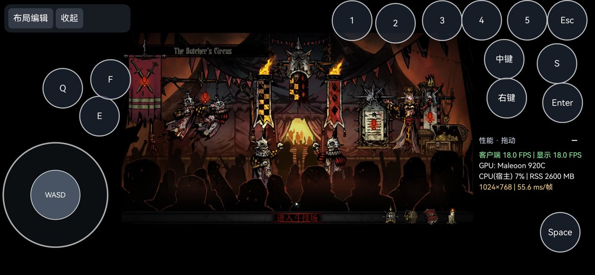

# fix(wine): 保留 IME 回退键盘消息的扫描码及释放标志

## 问题

在《暗黑地牢》指定的 `_windows/win64/Darkest.exe` 中，虚拟技能键和 Esc
有完整 evdev/Wayland 按下、抬起日志，普通来宾窗口也能收到 VK 值，游戏却没有响应。
Esc 保持约 100 ms 或约 1500 ms 均不能解决，说明不能只按触摸点按过短处理。

## 根因和修改

`ImmTranslateMessage()` 将原始键盘消息 `lParam` 的高 16 位作为 `vsc` 传给
`ImeToAsciiEx()`。IME 回退将这个字段直接写回完整 `lParam`，导致 SDL 从
bits 16–23 读不到正确扫描码，扩展、重复和释放标志的位置也错误。

本 PR 使用 `MAKELPARAM(1, vsc)` 重建消息参数，并在未消费输入的路径正确选择
`WM_IME_KEYDOWN` / `WM_IME_KEYUP`。保留现有 IME 和按键映射。

数字 1 的例子（展示 `lParam` 低 32 位）：

| 事件 | `vsc` | 原回退消息 | 修复后 |
| --- | --- | --- | --- |
| 按下 | `0x0002` | `0x00000002` | `0x00020001` |
| 抬起 | `0xc002` | `0x0000c002` | `0xc0020001` |

### 构建接线

- 在主仓库保留 [Wine 补丁](../../scripts/patches/wine-ime-key-scancode.patch)，由
  [build_wine.sh](../../scripts/build_wine.sh) 在编译前幂等应用。
- 反向探测使用 `--force` 固定方向，避免 GNU patch 自动忽略 `--reverse`，
  将尚未应用的补丁误判为已应用。
- 不修改 Wine gitlink，也不依赖本机未推送的第三方提交。

### 回归测试

[test_ime_key_scancode.py](../../scripts/test_ime_key_scancode.py) 提取实际
`ImeToAsciiEx()` 的两条消息初始化语句，编译后检查 10 类键、3 种状态、2 条路径，
共 60 项，覆盖扫描码、扩展位、重复/抬起位、repeat count 与消息类型。

原代码的扫描码断言失败，应用补丁后全部通过。该测试验证实际初始化语句的字段，
不是执行整个 Wine 输入法，也不是 60 次真实游戏验收。

在按项目要求配置的构建环境中执行：

```sh
make NATIVE_ARCH=arm64-v8a wine
python3 scripts/test_ime_key_scancode.py --cc cc
```

IME 测试读取已应用补丁的 Wine 源文件；仅构建 HAP 不会重新生成 Wine DLL 和载荷。
发布包仍需走完整 `make NATIVE_ARCH=arm64-v8a` 及项目要求的设备门禁。

## 设备证据

2026-10-29，在 nova 16 Pro / Maleoon 920C 上重建 x64/x86 `imm32.dll`，
基于已验证载荷仅替换两个 DLL，核对其余 ZIP 内容相同。修复后的虚拟 Esc
可打开竞技场菜单，用户随后反馈功能恢复。v17 签名 HAP 已覆盖安装，安装后
四份运行时/prefix DLL 的哈希和 manifest 已核对，引擎进入 `state:ready`。

这些是真实设备记录；**v17 来自包含其他适配工作的本地工作集，不等于已对本专项
分支完成完整 HAP 构建、干净环境重建或全部设备套件。**

修改前，已发送 Esc 按下/抬起，游戏仍停留在竞技场：



修改后，短按 Esc 打开游戏菜单：


截图仅用于展示输入响应，不能据此比较帧率。

## 提交范围与后续

基于 2026-10-30 核对的官方技术主线 `master` / `3eecbd7`。

本专项提交仅包含 Wine IME 补丁、最小构建接线、字段回归、截图与说明。
工作区中的桌面黑屏、触控时序、焦点恢复、图形性能和游戏库产品改动没有混入。
完整踩坑复盘保存在 [适配记录](../debugging/winehua-pitfalls-20261029.md)，其中其他主题
是后续拆分依据，不属于本 PR 的代码变更。

- [x] 原代码失败、修复后 60 项字段回归通过。
- [x] 从未应用补丁的源码 fixture 执行实际构建接线，首次应用和重复执行幂等均通过。
- [x] Shell/Python 语法、文档相对链接和公开材料检查通过。
- [x] 两架构 DLL 已在原适配环境重建，目标设备 Esc 响应恢复。
- [x] 原验证环境的 v17 HAP 已安装并核对 DLL/manifest；未重置 prefix 或存档。
- [ ] 本专项分支的干净环境完整构建。
- [ ] 按项目质量规范补齐 core、dxvk、d3d12 等设备套件。
- [ ] 中文 IME 组合输入、非游戏文本框、多设备和长按/重复键扩展验收。
- [ ] 技能 1～5 的每项独立图像验收。

建议先以 Draft PR 审阅。基于技术主线 `master`，目标修复不改变产品版本号、
品牌资源、签名配置、游戏存档或第三方指针。产品功能按仓库流程后续进入 `main-ui`。
